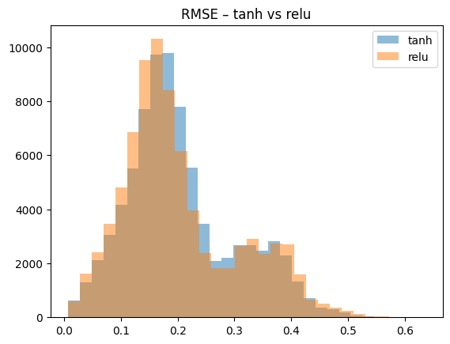
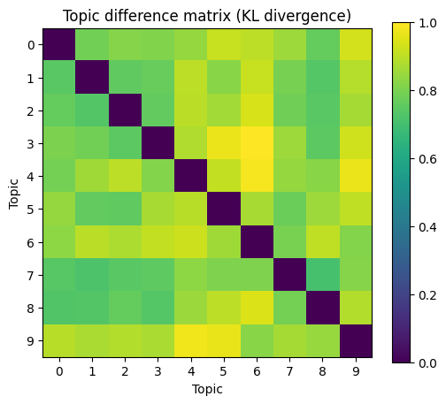

# HW3 Answers
## Qeuation 1

**stopwords = True**

Mean RMSE_tanh: 0.23333086

Mean RMSE_relu: 0.23362765

Best activation: tanh

 
 

**stopwords = False**

Mean RMSE_tanh: 0.20598993

Mean RMSE_relu: 0.2035242

Best activation: relu

 
 

**Stopword effect**

Removing stopwords significantly reduces RMSE, from ~0.233 to ~0.203.
Therefore, the better configuration is without stopwords.
And relu becomes the best activation under this setting.
 
 

**RMSE distribution histogram**

 
 

**True last two tokens** are ['rebel', 'slogans'].
 
 

**Predicted next word nearest neighbors**

word 1: says, ap, set, international, today.

word 2: ap, says, international, yesterday, set
 
 
 

## Question 2

**Without punctuation**

BERT accuracy: 0.004605263157894736

GPT-2 accuracy: 0.23157894736842105
 
 

**With punctuation**

BERT accuracy: 0.005263157894736842

GPT-2 accuracy: 0.24552631578947368
 
 

GPT-2 performs much better than BERT at next-word prediction, ~0.24 vs almost 0.
BERT is a masked-language model, not a next-token LM, so its accuracy is extremely low.
Punctuation improves both models, because both BERT and GPT-2 were pre-trained with punctuation as part of natural text.
Thus, GPT-2 is far better at next-word prediction. Keeping punctuation produces higher accuracy for both models.
 
 
 

## Question 3

**Topic 4 top 5 words:** team, win, season, game, s.

This topic appears to be related to sports, focusing on teams, games, and winning.
 
 

**The topic difference matrix (KL divergence)** is of shape (10, 10).
 
 

**topic difference（KL divergence）**

Darker cells indicate more similar topics; lighter cells indicate greater divergence across topics.

